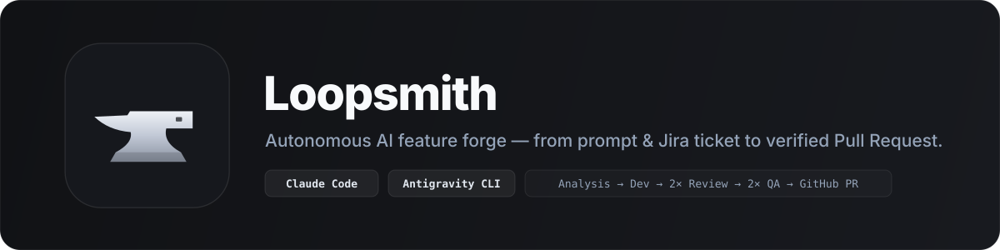

# Loopsmith: Brand & Design System

## 1. Identity & Philosophy

- **Name**: **Loopsmith**
- **Tagline**: *Autonomous AI feature forge: from prompt & Jira ticket to verified Pull Request.*
- **Visual Direction**: **Matte Carbon & Brushed Steel**: minimalist industrial craft. A sculpted blacksmith horn anvil in brushed steel/titanium over a deep matte carbon squircle, free of outlines or noisy color gradients.

## 2. Logo & App Icon

| Asset | Path | Description |
|---|---|---|
| **macOS App Icon (`.icns`)** | [`brand/AppIcon.icns`](brand/AppIcon.icns) | Multi-resolution (`16px` to `1024px`) macOS bundle icon |
| **Master Icon (`1024×1024`)** | [`brand/AppIcon-1024.png`](brand/AppIcon-1024.png) | High-resolution PNG preview |
| **Vector Emblem (`.svg`)** | [`brand/logo-mark.svg`](brand/logo-mark.svg) | Scalable vector anvil emblem |
| **Repository Banner (`.svg`)** | [`brand/banner.svg`](brand/banner.svg) | Header banner for documentation |
| **Generator Script** | [`scripts/generate-brand-assets.swift`](scripts/generate-brand-assets.swift) | Reproducible CoreGraphics icon generator |

### Icon Construction Principles
- **Symbol**: Classic blacksmith horn anvil with a clean top working face, horn step, hardy hole punch, curved waist, and beveled foot.
- **No Outlines**: Pure solid planes with subtle vertical metallic shading (`#F2F5F9` → `#C2C9D6` → `#8A92A1`) and a `14%` dark bevel on the foot.
- **Background**: Deep matte carbon squircle (`#202125` → `#121316`) with an `8%` white inner specular rim.

## 3. Color Tokens (`BrandTheme.swift`)

| Token | Hex | Role |
|---|---|---|
| `Brand.obsidian` | `#121315` | Deepest carbon base |
| `Brand.charcoal` | `#1C1D21` | Elevated surface / icon upper tone |
| `Brand.slate` | `#25272B` | Secondary surface |
| `Brand.steel` | `#D9DFE8` | Brushed steel highlight |
| `Brand.amber` | `#EC9925` | Primary action & active stage accent |
| `Brand.claude` | `#DA7D5C` | Claude Code provider indicator (`bolt.horizontal.fill`) |
| `Brand.gemini` | `#6196F5` | Gemini CLI provider indicator (`sparkles`) |
| `Brand.emerald` | `#21B882` | Passed checks / Ready for PR |
| `Brand.crimson` | `#E84A4A` | Blocker finding / Error state |

