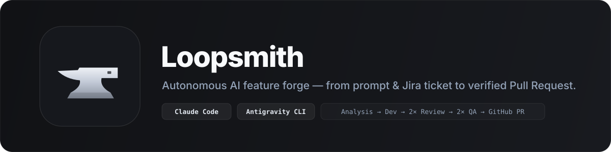

# Loopsmith



A native macOS app that takes a feature from a prompt to a pull request with **Claude Code**, **Antigravity CLI** or **Gemini CLI** agents:

```
project folder → brief agent writes the project's brief (once, given to every agent)

prompt / Jira ticket
   → git worktree for the feature
   → analysis agent: feasibility, approach, problems to handle, acceptance criteria
   → dev agent (Claude Code, Antigravity CLI or Gemini CLI) implements
   → 2 independent review agents, no shared context  ─┐ blocking findings go back to dev,
   → 2 QA agents run the checks and test the feature  ─┘ up to N fix rounds per stage
   → you open the pull request from the app

after every step, the pipeline stops until you approve it
```

It also shows your Jira worklog for the day, lets you log time on a ticket, and lists your open pull requests on GitHub.

## How it works

- **Projects.** Add a repository once. An agent reads it and writes a brief: what the project is, stack
  and layout, setup in a fresh worktree, lint/test/build commands and CI gates, conventions, pitfalls.
  Every agent of the project's features gets it. You can edit it or have it rewritten from the project page.
- **One worktree per feature.** Pick a project, a base branch and optionally a Jira ticket.
  Loopsmith fetches the base, creates `feat/<ticket>-<title>` in `<worktrees folder>/<repo>/<slug>` and
  copies the untracked files you list (`.env` by default).
- **Agents are your own CLIs.** Each agent is a `claude -p`, `agy --print` or `gemini -p` process run in the worktree,
  with your login, settings, `CLAUDE.md` / `GEMINI.md`, MCP servers, skills and plugins. Each role (analysis, dev,
  review, QA) picks its model in Settings: `claude-*` runs on Claude Code, `agy:<model>` on the Antigravity CLI
  (`agy:gemini-4-argon-high`, `agy:claude-opus-5-5-high`: the list comes from `agy models`), `gemini-*` on Gemini CLI.
  Nothing is sent anywhere else.
- **Analysis** comes first: a read-only agent studies the request against the code and answers with its
  feasibility (feasible, risky, blocked), the approach that fits the codebase, the files involved, the problems
  the developer must handle, its assumptions and acceptance criteria. The dev agent gets all of it; review and
  QA get the acceptance criteria. A blocked request pauses the feature until you continue.
- **Dev** works in one session for the whole feature, so fix rounds keep its context (`--resume`).
- **Review**: two fresh sessions that only see the request and the diff against the base commit.
  One hunts bugs, the other checks the change against the request and the repo conventions.
  They cannot edit files and answer with a JSON verdict (`--json-schema`).
- **QA**: two fresh sessions. One finds and runs the project's gates (lint, tests, build),
  the other exercises the feature against the request. They cannot edit files either.
- **You approve each step.** After the analysis, the development, each review and each QA round, the
  feature waits for you. Approve it, with an optional note the next agents get, or send it back: redo the
  analysis, ask the dev agent for changes, untick the findings that are not real before they go to dev, or
  skip the fixes. "Show diff" displays what the agents changed. Settings can turn the approvals off to run
  the whole pipeline in one go.
- Blocker and major findings go back to the dev agent. When the fix rounds run out, what is left is
  listed as open points and copied into the PR description.
- **Pull request**: you review the title and description, then Loopsmith commits the worktree, pushes the
  branch and runs `gh pr create`. Agents never commit or push.
- **Tools per project and per feature**: every MCP server and skill your CLIs have is on by default.
  Switch off the ones a feature does not need (Tools button): Claude Code denies them with `--disallowedTools`,
  Antigravity with session-only `mcp(<server>/.*)` deny rules, Gemini CLI with `--allowed-mcp-server-names`.
  Skills can only be switched off for Claude Code agents. Each project holds the default set for its new features.
- **Stop / Continue**: stopping kills the agents; Continue resumes from the current step. Features and
  agent logs are kept in `~/Library/Application Support/Loopsmith`.

## Requirements

- macOS 14 or later, Xcode 15 or later (or the Swift 5.10+ toolchain)
- At least one agent CLI installed and logged in, on your PATH: [Claude Code](https://docs.claude.com/en/docs/claude-code)
  (`claude`), the Antigravity CLI (`agy`) or [Gemini CLI](https://github.com/google-gemini/gemini-cli) (`gemini`)
- [GitHub CLI](https://cli.github.com) logged in (`gh auth login`), for pull requests
- Optional: a Jira Cloud site, your email and an [API token](https://id.atlassian.com/manage-profile/security/api-tokens), for tickets and worklogs.
  The token is stored in the macOS keychain.

## Build and run

```bash
swift run                         # development
./scripts/build-app.sh            # build/Loopsmith.app (ad-hoc signed)
./scripts/build-app.sh --install  # and copy it to /Applications
```

The app reads your login shell's `PATH`, so `claude`, `gh`, `node` or `npm` are found even when it is opened from the Finder.

## Try it locally

1. Build and open the app: `./scripts/build-app.sh --install`, then open Loopsmith from Applications.
2. Optional: Settings (⌘,) → Jira, to pick tickets and log work. To keep a first try cheap, set the
   models to `claude-sonnet-5-5` or `claude-haiku-5-5` in Settings → Agents.
3. **Add project** (⇧⌘N) and choose a git repository. An agent writes its brief; read it on the project page.
4. **New feature** (⌘N): pick the project, a base branch, optionally a ticket, and describe the feature.
5. Approve each step from the feature page. The worktree lives in `~/Loopsmith/<repo>/<feature>`: open it
   in your editor at any time.
6. **Create PR** commits, pushes the branch and opens the pull request: try it on a repository where
   pushing a test branch is fine.

## Settings

| Setting | Default |
|---|---|
| Worktrees folder | `~/Loopsmith` |
| Models (analysis and brief, dev, review, QA) | `claude-opus-5-5` |
| Wait for my approval after each step | on |
| Permission mode | `auto`: Claude Code's classifier approves safe actions; Gemini CLI has no classifier and runs every tool. `acceptEdits` denies shell commands the agents would need for tests. `bypassPermissions` runs everything unchecked. |
| Antigravity permissions | `auto` uses agy's auto mode. Some accounts have none: headless `agy` then refuses whatever your agy rules do not allow, and the step fails with agy's message. `bypassPermissions` allows every command through session rules (never `--dangerously-skip-permissions`), so analysis, review and QA agents still cannot write files and switched-off MCP servers stay off. |
| Fix rounds after review and after QA | 2 |
| Files copied into new worktrees | `.env, .env.local` |
| My issues (JQL) | `assignee = currentUser() AND statusCategory != Done ORDER BY updated DESC` |
| Daily worklog target | 8h |

## Tests

```bash
swift test                                                   # unit tests
LOOPSMITH_E2E=1 LOOPSMITH_HOME=$(mktemp -d) swift test --filter EndToEnd
LOOPSMITH_E2E=1 LOOPSMITH_E2E_MODEL=agy:gemini-3.8-flash-low LOOPSMITH_HOME=$(mktemp -d) swift test --filter EndToEnd
```

The end-to-end test runs the whole flow (project brief, analysis, dev, review, QA) with Claude Haiku on a throwaway repository (a few minutes, a few cents).
`LOOPSMITH_HOME` keeps its features and settings away from yours.

## License

MIT
